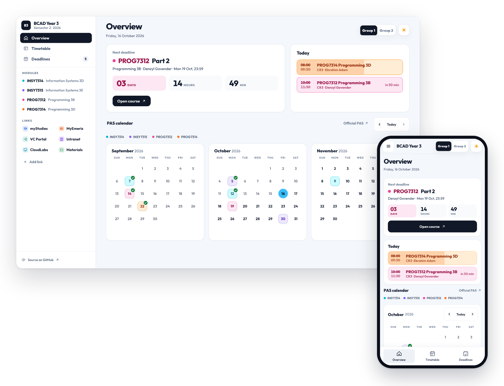
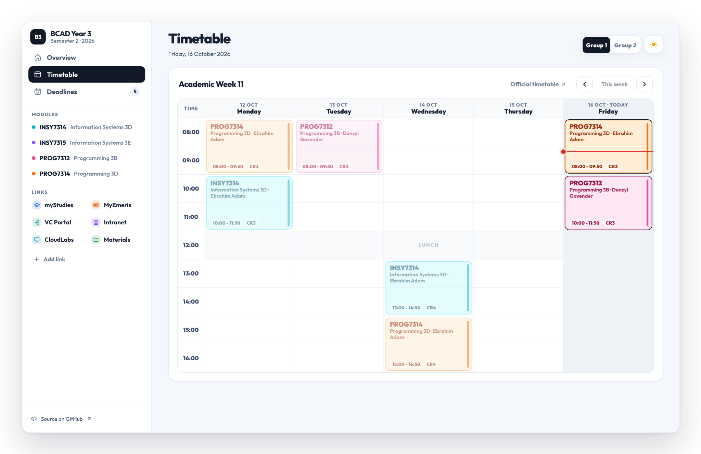
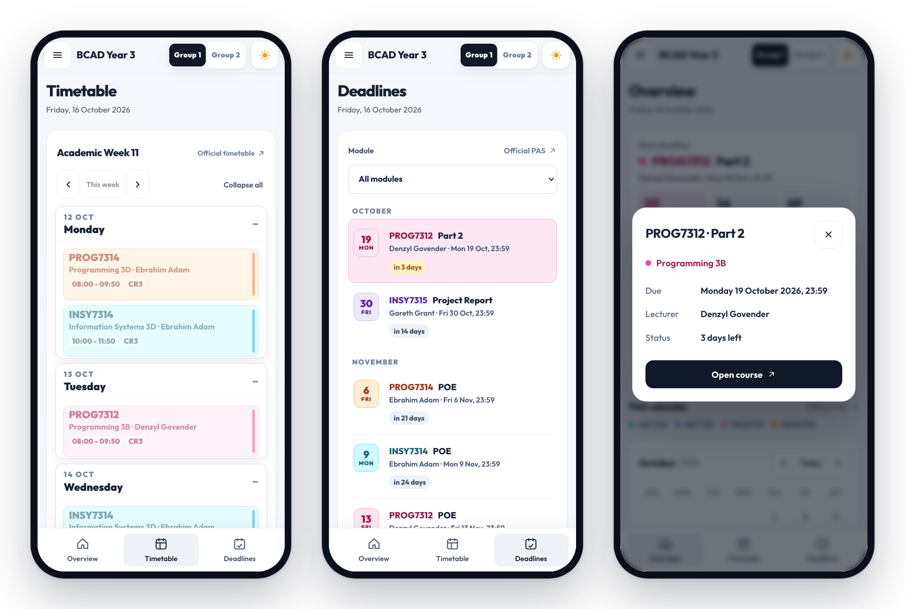

<div align="center">

# BCAD Year 3 Dashboard

Deadlines, classes, timetables and study links for BCAD Year 3 at Emeris Durban North, in one place.

**[Open the dashboard](https://zenwyn-naicker.github.io/bcad-dashboard/)**

</div>

<picture>
  <source media="(prefers-color-scheme: dark)" srcset="docs/screenshots/overview-dark.png">
  
</picture>

## Features

- **Next deadline** with a live countdown to 23:59, plus a deadline list you can filter by module. Finished assessments drop off automatically.
- **Today's classes** with venues and lecturers, a card that fills as the lecture in session runs, and when the next one starts.
- **Weekly timetables** for Group 1 and Group 2, including catch-up, test and assessment weeks.
- **PAS calendar** coloured by module, with details for every assessment date.
- **Study links** to myStudies, MyEmeris, VC Portal, the Intranet, Student Materials and CloudLabs, plus links you add yourself.
- **Light and dark themes**, a phone layout with bottom navigation, keyboard shortcuts and reduced-motion support. It can be added to a phone's home screen.

## Screenshots

<picture>
  <source media="(prefers-color-scheme: dark)" srcset="docs/screenshots/timetable-dark.png">
  
</picture>

<picture>
  <source media="(prefers-color-scheme: dark)" srcset="docs/screenshots/mobile-dark.png">
  
</picture>

## Dates and sources

All dates, class times and countdowns use **South African Standard Time** (Africa/Johannesburg, UTC+2), whatever timezone the device is in.

Assessments are due at **23:59 SAST** on the listed date. They finish at the following midnight and leave the deadline list. "Finished" is based on the date only; the dashboard does not read submissions from myStudies.

| Content | Source |
| --- | --- |
| Assessment dates | PAS Version 4, 23 September 2026 (ICE and resubmission dates are not included) |
| Classes, venues and lecturers | Official Semester 2 2026 timetable, Groups 1 and 2 |

Links to the official PAS and timetable are inside the dashboard. Check any academic change against those sources.

## Privacy

Your theme, class group and saved links are stored in your browser only. The page loads no analytics or third-party scripts; the only outside requests are the icons for links you add, which come from those sites.

## Run locally

Requires **Node.js 22 or later**. There are no packages to install and no build step.

```sh
git clone https://github.com/zenwyn-naicker/bcad-dashboard.git
cd bcad-dashboard
npm run dev      # http://127.0.0.1:4173
```

```sh
npm test         # Date, countdown, completion and academic data checks
npm run check    # Syntax checks plus all tests (also run by GitHub Actions)
```

The repository root can be served as-is by GitHub Pages or any static host.

## Project structure

```text
index.html                  Page structure and initial theme and group setup
manifest.webmanifest        Home-screen app details
assets/data.js              Semester, modules, assessments, timetables and links
assets/model.js             SAST date maths, assessment completion and data checks
assets/app.js               Rendering, navigation and interactions
assets/styles.css           Design tokens, components and responsive layouts
assets/fonts/               Outfit font files and licence
assets/icons/               Home-screen icons
assets/social-preview.jpg   Image shown when the link is shared
scripts/serve.mjs           Local static server
tests/model.test.js         Dependency-free tests
docs/screenshots/           README screenshots
.github/workflows/check.yml Continuous checks
```

## Keyboard shortcuts

| Key | Action |
| --- | --- |
| `1` `2` `3` | Overview, Timetable, Deadlines |
| `G` | Switch class group |
| `T` | Jump to the current (or coming) timetable week |
| `←` `→` | Previous or next week, or calendar month |
| `Esc` | Close assessment details, the menu or the add-link form |

Shortcuts pause while you type in a field.

## Built with

HTML, CSS and vanilla JavaScript, with no framework, bundler or runtime dependencies. Typeset in [Outfit](https://github.com/Outfitio/Outfit-Fonts) (SIL Open Font License).
